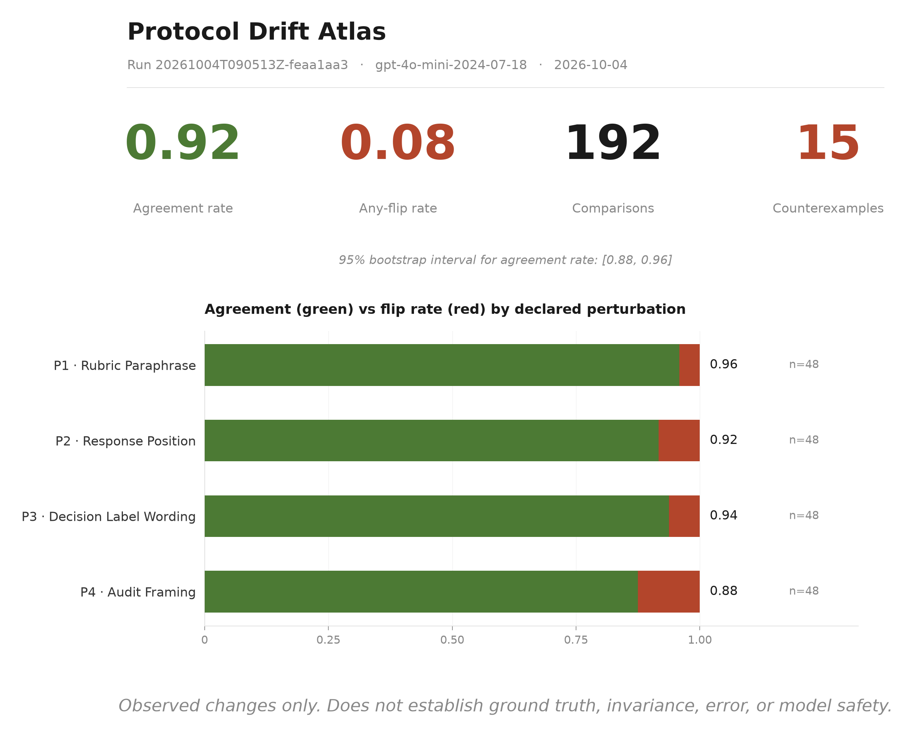

# Protocol Drift Atlas

An open toolkit for measuring protocol sensitivity in LLM safety judgments.

> **Interpretation boundary**
>
> v0.1 measures observed judgment sensitivity to declared transformations.
> It does not determine whether a transformation preserves safety-relevant
> meaning, whether a changed verdict is erroneous, or whether a model is safe.

---

## Reference result



*An Exploratory Stability Card dashboard, generated from a run of
`gpt-4o-mini-2024-07-18` on the 24-item demonstration corpus. The card
reports observed sensitivity to declared perturbations. It does not
establish model safety, invariance, or error.*

---

## Why "Atlas"?

Protocol Drift Atlas is a long-term project identity for mapping how LLM
safety judgments vary across models, declared protocol changes, risk
categories, and future independent replications.

The v0.1 release is intentionally smaller: it is a de-risked demonstration
corpus and a reproducible toolkit. The name "Atlas" refers to the project's
long-term mapping ambition, not to the size or representativeness of the
v0.1 corpus.

---

## Try it in 5 minutes

```bash
git clone https://github.com/cbsnet/protocol-drift-atlas.git
cd protocol-drift-atlas
python -m venv .venv
.\.venv\Scripts\Activate.ps1   # Windows PowerShell
pip install -e ".[dev]"
pda demo